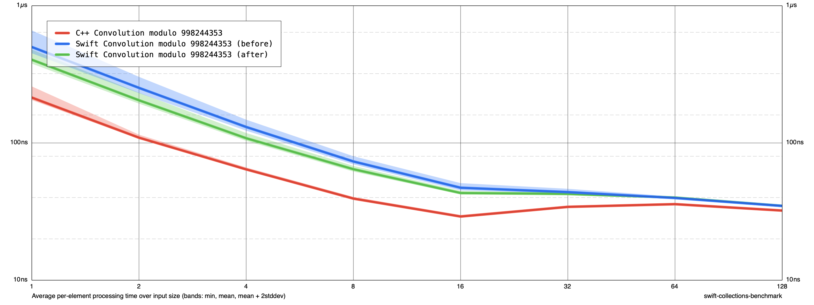
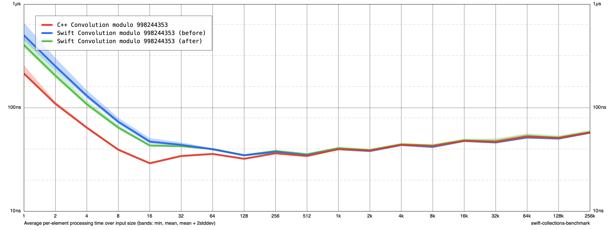

# Small convolution conversion overhead

Based on 7d3ef53, changes in changes.diff. The naive convolution loop already used buffers and wrapping modular arithmetic. This change removes the remaining explicit result-length overflow checks in the naive allocator and integer input wrapper, and replaces zero-filled conversion arrays with direct map construction. Butterfly code, the threshold of 60, and modular arithmetic are unchanged.

Release -O, Apple M1, no sanitizers. Before/after/after/before, five cycles each, ten samples per size. Includes integer/modint conversions, construction and destruction. 69 extended C++ comparison cases passed.

| N | Swift before ns/input | Swift after | C++ after |
|---|---:|---:|---:|
|1|500.33|404.16|214.21|
|4|130.74|108.31|64.20|
|16|47.19|43.18|29.12|
|32|43.85|42.55|34.23|
|64|39.73|40.01|35.83|
|262144|57.42|58.32|57.82|

Small sizes improve; large sizes show little change in this measurement. Not a general performance guarantee.

