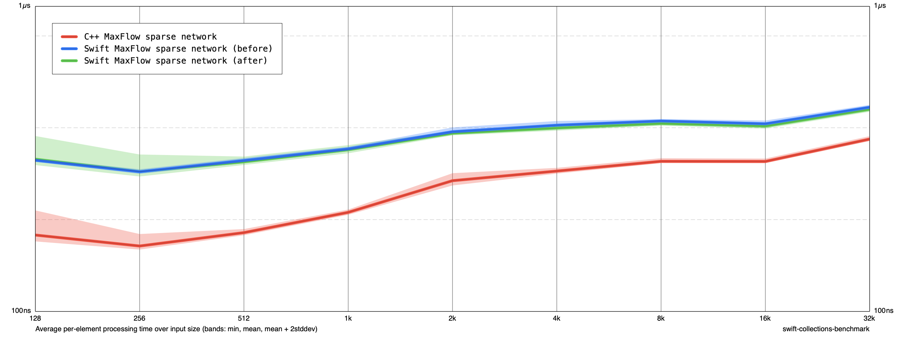

# MaxFlow edge insertion borrowing

Both baselines include the preceding pruning and BFS queue changes. add_edge now borrows the outer adjacency array once while adding the forward and reverse edges. Inner arrays still manage their own storage.

Release -O, Apple M1, no sanitizers. Before/after/after/before, five cycles each, ten measurements per size, construction and teardown included. At 32K: Swift 467.10 → 459.62 ns/input (1.6% reduction); C++ 361.69 → 367.26. At 8K: Swift 421.03 → 413.12. This is a small workload-specific improvement, not a general guarantee. All 69 extended C++ comparison cases pass.

An earlier separate trial replaced Optional next() with a local Int loop in DFS: Swift 469.33 → 473.22 ns/input at 32K, C++ 364.79 → 366.23. No improvement; that trial was reverted. Raw measurements are retained as dfs-trial-*.json.

changes.diff contains only the edge-insertion change relative to the queue/pruning baseline.

