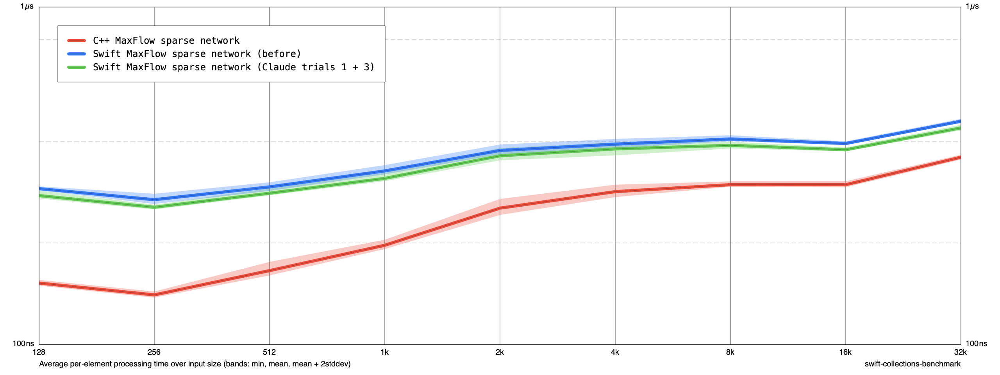

# MaxFlow tuning trials (maxflow-tuning-013, Claude)

Base: e447f67. Release -O, Apple M1, no sanitizers. Each trial measured
before/after/after/before, five cycles per invocation (ten samples per size),
sizes 128–32K, MaxFlow sparse network only, construction and teardown
included. Values are mean ns/input. The C++ code is identical in both
binaries, so its movement shows layout/order noise.

| Trial | Base → after | Swift 128 | Swift 32K | C++ 32K | Result |
| --- | --- | ---: | ---: | ---: | --- |
| 1. DFS frame stack as a vertex-count buffer reused per flow call | e447f67 → t1 | −5.9% | 472.85 → 449.83 (−4.9%) | −3.7% | kept |
| 1 (repeat) | e447f67 → t1 | −7.6% | 472.22 → 451.12 (−4.5%) | −2.8% | |
| 2. reserveCapacity(4) on first edge of each inner array | t1 → t1+t2 | −29.7% | 450.20 → 367.94 (−18.3%) | +0.7% | not kept; policy decision |
| 3. BFS borrows g[v] once per vertex, hoists level[v]+1 | t1 → t1+t3 | −2.6% | 456.50 → 438.25 (−4.0%) | −0.2% | kept |
| 4. DFS edge scan in g[v].withUnsafeBufferPointer, return handling hoisted | t1+t3 → +t4 | +4.1% | 437.36 → 451.33 (+3.2%) | +0.1% | reverted |
| Cumulative (1 + 3) | e447f67 → final | −4.6% | 458.88 → 438.45 (−4.5%) | −1.2% | |

The cumulative reduction is smaller than the sum of the individual trials;
individual trial numbers include noise. Trial 2 fits this workload closely
(almost every vertex has exactly four edge entries) and raises memory use for
low-degree vertices; its effect on other graph shapes is unmeasured.

Known trade-off of trial 1: the frame buffer is allocated and initialized
for every vertex on each `flow` call, instead of growing to the actual
maximum DFS depth. Each entry is `(Int, Cap, Cap)`; for `Cap == Int` this
adds 24 bytes per vertex, comparable to the existing `level`, `iter` and
`queue` buffers combined. Memory use and initialization work increase most
for large graphs whose s–t paths are shallow, for repeated `flow` calls that
do little work, and for large `Cap` types. These cases were not measured.

Profile-based absolute estimates (construction ≈130 vs ≈65 ns/input, and
similar figures for DFS and BFS) multiply each trace's sample ratio by
benchmark times from another run. Their conditions and denominators do not
match exactly, so they are rough reference estimates for the construction
hypothesis, not direct measurements.

Correctness: benchmark verify-extended 69/69 PASS for each binary (t1–t4,
final). `swift test --filter maxFlowTests` passes in debug and release.

Files: changes.diff (final, trials 1 + 3), trial1.diff,
trial2-cumulative.diff (1 + 2), trial4-cumulative.diff (1 + 3 + 4),
per-trial raw JSON and summary.md, measure.sh and summarize.py.

Rerun: build `Benchmarks` in release for each source state, copy the
`benchmark` binary, then `sh measure.sh <dir> <before-binary> <after-binary>`.

## Chart

Final candidate (trials 1 + 3), not yet accepted. C++ uses the after-run samples.

