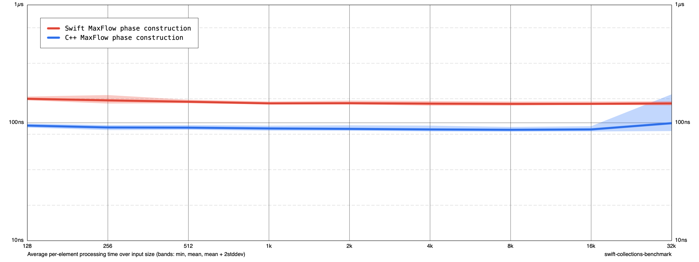
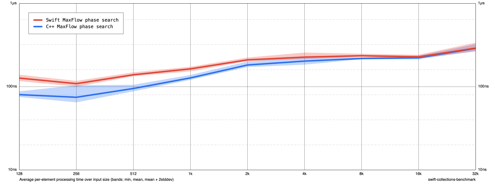
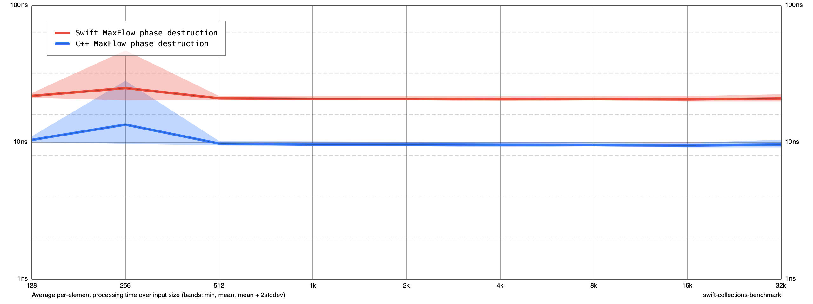

# Maximum-flow phase measurements

Library: 26015a2 (accepted Claude trials 1 + 3). Benchmark-only changes add explicit lifetime boundaries; product code is unchanged.

Release -O, C++ -O3 -DNDEBUG, Apple M1, no sanitizers. Same fixed-seed sparse network as the existing end-to-end benchmark. Sizes 128–32768, two invocations of five cycles (10 samples per size/task); arithmetic mean, ns per input element (not per edge). Swift Int and C++ intptr_t capacities; native index widths retained.

Each timed sample uses a fresh graph, including repeated measurements inside one benchmark cycle. Construction includes allocation and edge insertion but excludes destruction. Search excludes graph construction/destruction but includes flow's internal buffers and their teardown. Destruction measures a freshly constructed, unsolved graph. C++ uses an opaque heap-owned wrapper (one extra allocation/deallocation). Swift uses its noncopyable graph without a CoW snapshot. Input creation is excluded. The end-to-end tasks are the original unchanged workloads, including output handling.

Six sizes including 32768 were checked against C++ and the original Swift workload; all returned equal flows. This validates the measurement workload, not all graph shapes.

| Size | Phase | Swift ns/input | C++ ns/input | Swift/C++ |
|---:|---|---:|---:|---:|
| 128 | sparse network | 300.56 | 184.64 | 1.63 |
| 128 | phase construction | 159.86 | 94.79 | 1.69 |
| 128 | phase search | 126.92 | 80.37 | 1.58 |
| 128 | phase destruction | 21.91 | 10.45 | 2.10 |
| 1024 | sparse network | 339.38 | 220.67 | 1.54 |
| 1024 | phase construction | 146.16 | 89.58 | 1.63 |
| 1024 | phase search | 163.92 | 127.62 | 1.28 |
| 1024 | phase destruction | 20.87 | 9.66 | 2.16 |
| 32768 | sparse network | 468.37 | 392.31 | 1.19 |
| 32768 | phase construction | 146.10 | 99.29 | 1.47 |
| 32768 | phase search | 291.15 | 288.93 | 1.01 |
| 32768 | phase destruction | 21.00 | 9.65 | 2.18 |

At 32K the isolated search is nearly equal, while construction and destruction remain slower in Swift. At 128 and 1K, search also contributes to the gap. These are observations on this specific sparse network, not a general statement about maximum-flow performance.

Do not add these isolated timings and treat them as an exact decomposition of the end-to-end measurement: lifetime boundaries, allocation/caches, generated code, and output handling differ. Timing drift was visible between the two runs; raw samples are retained. Earlier trace-proportion estimates were hypotheses, not direct phase measurements.





## Reproduce

From Benchmarks, build with the Xcode toolchain, then run:

```sh
TOOLCHAINS=com.apple.dt.toolchain.XcodeDefault xcrun swift build -c release
.build/out/Products/Release/benchmark verify-flow-phases
.build/out/Products/Release/benchmark run /tmp/maxflow-phases.json --filter MaxFlow --min-size 128 --max-size 32K --smoothness 1 --cycles 5 --disable-cutoff true
.build/out/Products/Release/benchmark run /tmp/maxflow-phases.json --filter MaxFlow --min-size 128 --max-size 32K --smoothness 1 --cycles 5 --disable-cutoff true --mode append
.build/out/Products/Release/benchmark render /tmp/maxflow-phases.json /tmp/maxflow-phases.png
```
