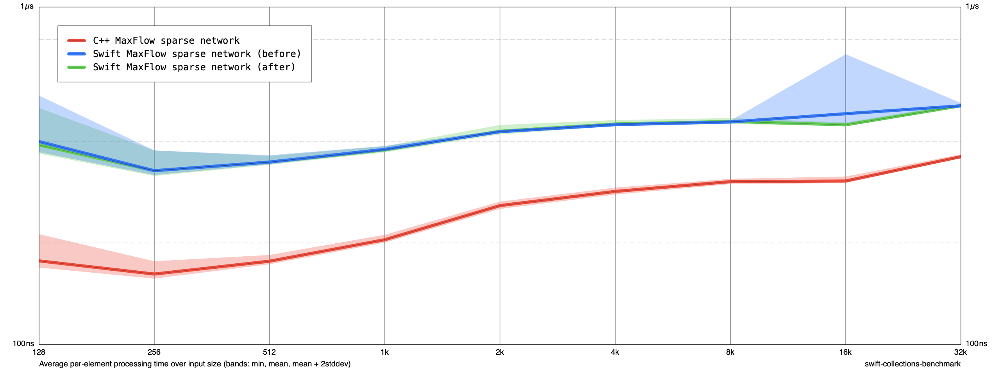

# MaxFlow exhausted-vertex pruning

Based on 7464bc7. Move level[v] = _n into the exhausted DFS frame, matching the original recursive ACL implementation. Previously it ran only after the entire explicit stack was empty, for the initial vertex. No BFS or storage changes.

Release -O on Apple M1, no sanitizers. Before/after/after/before, five cycles each (ten samples per size), sizes 128–32K. Construction and destruction included. All 69 extended C++ comparison cases passed.

At 32K, Swift mean ns/input: 509.77 → 509.96; C++ 362.50 → 360.36. No material performance improvement in this sparse-network workload. This does not establish the effect on other graph shapes.

