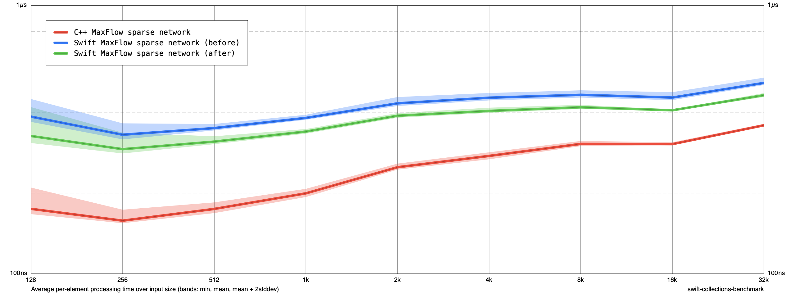

# MaxFlow reusable BFS queue

Both measurements include the preceding exhausted-vertex pruning correction. Replace the per-BFS Deque with an Int array allocated once per flow call, borrowed as a mutable buffer once per BFS. Each vertex is enqueued at most once, so vertex-count capacity suffices. Head/tail offsets reset without clearing the buffer. No per-enqueue/dequeue CoW check; edge-array CoW checks remain.

Release -O, Apple M1, no sanitizers. Before/after/after/before, five cycles each (ten samples per size), 128–32K. Includes construction and destruction. All 69 extended C++ comparison cases passed.

At 32K, mean ns/input: Swift 514.84 → 463.38 (10.0% reduction); unchanged C++ 366.50 → 357.91 (2.3% reduction). At 1K: Swift 381.18 → 339.08. This measures queue reuse and buffer operations together, not their individual contributions.

changes.diff is cumulative from 7464bc7 and includes the preceding pruning correction.

