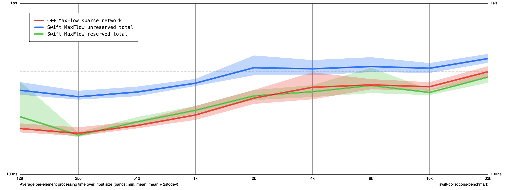
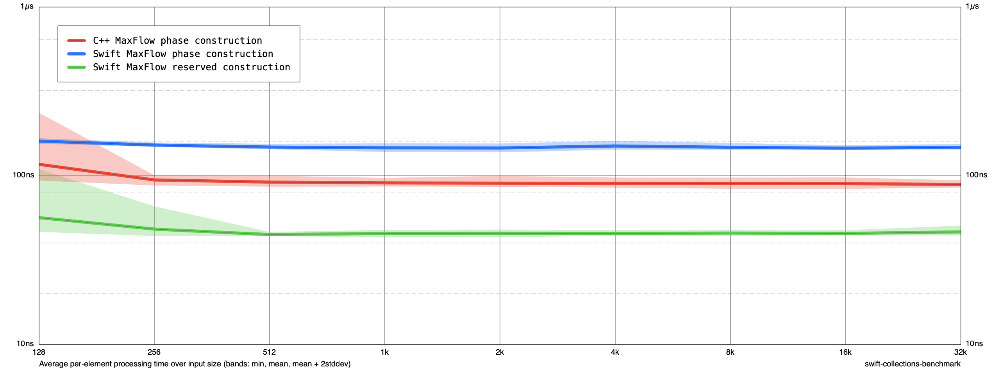

# Explicit maximum-flow edge reservation experiment

Based on 26015a2 plus the accompanying phase benchmark and reservation changes. No automatic capacity policy was added to `add_edge`.

## API prototype

```swift
var graph = MFGraph<Int>(count: vertexCount)
// Increment counts[from] and counts[to] once per planned directed edge.
// A self-loop increments the same count twice, because of its reverse edge.
graph.reserveCapacity(edgeCounts: counts)
// Register edges as usual.
```

Counts are total desired adjacency capacities, not additional capacities. Both incoming and outgoing edges contribute because the residual graph stores reverse edges. The edge-position table is reserved for half the sum. Reservation is optional and changes no edge IDs, capacities, or flows; subsequent growth remains possible. This is an experimental reservation API saved as a checkpoint before reviewing the earlier tuning.

## Measurement

Release Swift -O / C++ -O3 -DNDEBUG, Apple M1, no sanitizers. Same fixed-seed sparse network as earlier. Sizes 128–32768, two invocations of five cycles (10 samples per task/size), mean ns/input. Degree-array construction, counting both endpoints, reservation, and degree-array destruction are included in the reserved construction/total measurements. Inputs are generated outside timing. Both Swift total variants use the same builder and output handling. C++ is the original unreserved workload; this is not a reserved-vs-reserved language comparison.

| Size | Swift total unreserved | Swift total reserved | C++ total unreserved | Swift build unreserved | Swift build reserved |
|---:|---:|---:|---:|---:|---:|
| 128 | 311.18 | 218.25 | 185.91 | 160.48 | 56.48 |
| 1024 | 342.40 | 237.63 | 223.07 | 146.48 | 45.52 |
| 32768 | 477.09 | 371.99 | 399.73 | 147.64 | 46.52 |

At 32K, reservation reduces construction time by about 68.5% and total time by about 22.0%. The reserved total is about 6.9% below the original C++ total in this workload. Isolated timings are not an exact additive decomposition of total time, due to lifetime/cache/code-generation differences.

Six sizes (1, 2, 17, 128, 1024, 32768) return identical flows for reserved Swift, unreserved Swift, and C++. A focused test also checks self-loops, parallel edges, stable edge indices/values after reservation, reservation after partial flow, additional registration, and completion of residual flow. Test and comparison logs are retained.

The benchmark can count endpoints before constructing the graph. Streaming callers without advance edge information cannot gain this benefit without buffering/preprocessing. Other graph shapes and allocation/peak-memory measurements were not evaluated. The counts scratch array costs O(V) additional temporary storage, while reservation avoids repeated adjacency growth. No universal speed or memory claim is made.




## Reproduce

From Benchmarks:

```sh
TOOLCHAINS=com.apple.dt.toolchain.XcodeDefault xcrun swift build -c release
.build/out/Products/Release/benchmark verify-flow-phases
.build/out/Products/Release/benchmark run /tmp/maxflow-reserved.json --filter MaxFlow --min-size 128 --max-size 32K --smoothness 1 --cycles 5 --disable-cutoff true
.build/out/Products/Release/benchmark run /tmp/maxflow-reserved.json --filter MaxFlow --min-size 128 --max-size 32K --smoothness 1 --cycles 5 --disable-cutoff true --mode append
```
