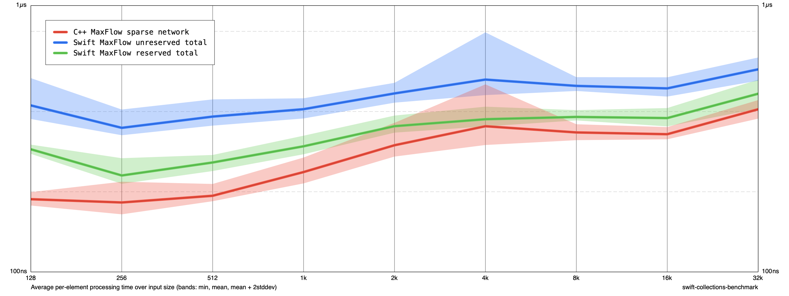

# Maximum flow after reverting tuning

Base commit 6d91848 plus maxflow.swift changes.diff: restore the 4adfc2a implementation, retaining explicit edge reservation and the corrected exhausted-vertex pruning. Earlier explicit-stack DFS remains. No fixed-size frame/queue tuning or unchecked-arithmetic changes remain in maxflow.swift.

Release Swift -O, C++ -O3 -DNDEBUG, Apple M1, no sanitizers. Same fixed-seed sparse-network input, sizes 128–32K, two runs of five cycles (10 samples per task/size). Mean ns/input. Total includes construction, flow, and destruction. Reserved Swift includes endpoint counting and reservation. C++ is unreserved. This is a workload-specific comparison, not a general language ranking. Older tuning results were measured separately and should not be compared as a controlled before/after experiment.

| Size | C++ unreserved | Swift unreserved | Swift reserved |
|---:|---:|---:|---:|
| 128 | 187.57 | 421.93 | 288.76 |
| 1024 | 237.14 | 408.33 | 296.31 |
| 32768 | 408.01 | 576.31 | 466.74 |



Reproduce from Benchmarks after building the current source:

```sh
TOOLCHAINS=com.apple.dt.toolchain.XcodeDefault xcrun swift build -c release
.build/out/Products/Release/benchmark run /tmp/restored.json --filter MaxFlow --min-size 128 --max-size 32K --smoothness 1 --cycles 5 --disable-cutoff true
.build/out/Products/Release/benchmark run /tmp/restored.json --filter MaxFlow --min-size 128 --max-size 32K --smoothness 1 --cycles 5 --disable-cutoff true --mode append
```

Debug maximum-flow tests (11), release tests (10), and six-size reserved/unreserved/C++ result comparisons passed before this measurement. No further product changes were made for chart generation.
