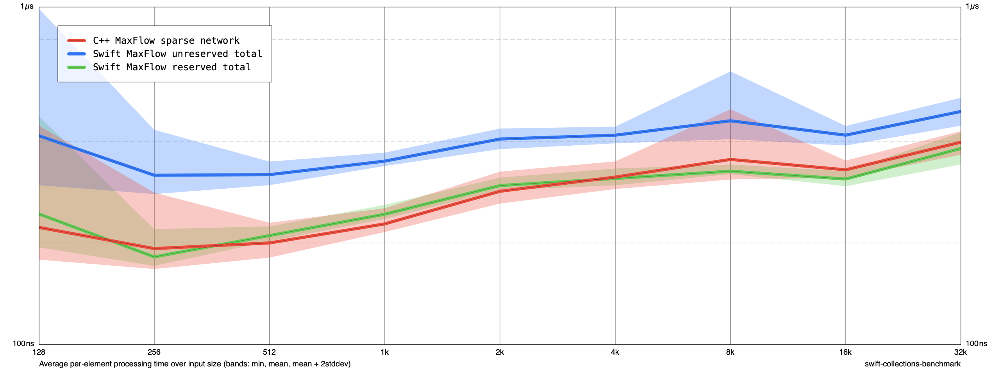

# Maximum flow: storage optimizations reapplied

Base 6d91848 with accompanying changes.diff. Explicit edge reservation retained; add_edge outer buffer borrowing, BFS adjacency borrowing and reusable BFS queue retained. Arithmetic remains ordinary checked arithmetic, and DFS uses append/popLast frames. Correct exhausted-vertex pruning retained.

Release Swift -O, C++ -O3 -DNDEBUG, Apple M1, no sanitizers. Same fixed-seed sparse network, sizes 128–32768, 10 cycles, arithmetic mean ns/input. Total includes construction, search and destruction; reserved Swift includes degree counting and reservation. C++ is unreserved. Earlier charts were measured separately and are not a controlled before/after comparison. Scope is this input family only.

| Size | C++ unreserved | Swift unreserved | Swift reserved |
|---:|---:|---:|---:|
| 128 | 222.36 | 415.48 | 243.56 |
| 1024 | 227.77 | 349.54 | 243.35 |
| 32768 | 397.74 | 490.39 | 381.03 |



Reproduce from Benchmarks after building:

```sh
.build/out/Products/Release/benchmark run /tmp/storage.json --filter MaxFlow --min-size 128 --max-size 32K --smoothness 1 --cycles 10 --disable-cutoff true
```

Debug 11 tests, Release 10 tests and six-size C++/Swift reserved/unreserved flow comparison passed before measurement.
