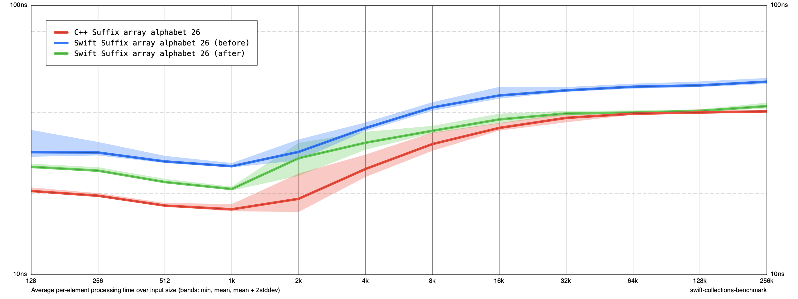

# Suffix array arithmetic and buffer update

Based on 814d280, with the accompanying string.swift changes.diff. Same SA-IS algorithm and 64-bit indices. The induce operation borrows its mutable array for the entire operation; explicit Int arithmetic within SA-IS uses wrapping operators under the original valid-input assumptions.

Release -O, Apple M1, no sanitizers. Before/after/after/before, five cycles per invocation, ten samples per size. Sizes 128–256K, alphabet 26. Construction and teardown included.

At 256K, mean ns/input: Swift 52.16 → 42.31 (18.9% lower); unchanged C++ 40.68 → 40.45. These are workload-specific results. All 69 extended verification cases pass. Generated Int-specialized induce buffer loop contains no uniqueness calls or b.vs instructions; the outer buffer borrow still establishes uniqueness.

